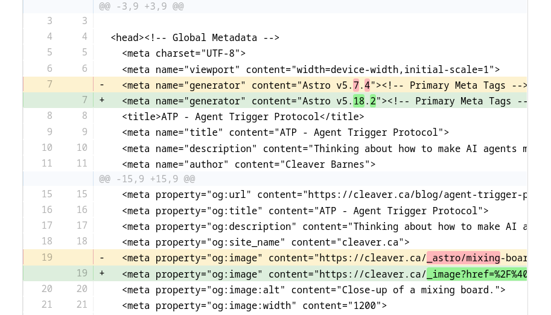

---
# try also 'default' to start simple
theme: seriph
# random image from a curated Unsplash collection by Anthony
# like them? see https://unsplash.com/collections/94734566/slidev
background: /images/mahdi-bafande-sm8EGYlNSVQ-unsplash.jpg
# some information about your slides (markdown enabled)
title: Breakcheck
info: |
  ## Breakcheck presentation
  Presentation slides for developers.

  Learn more on [Github](https://github.com/cleaver/breakcheck)
# apply UnoCSS classes to the current slide
class: text-center
# https://sli.dev/features/drawing
drawings:
  persist: false
# slide transition: https://sli.dev/guide/animations.html#slide-transitions
transition: slide-left
# enable Comark Syntax: https://comark.dev/syntax/markdown
comark: true
# duration of the presentation
duration: 35min
---

# Breakcheck

Acceptance testing/Agentic development/The future

<div @click="$slidev.nav.next" class="mt-12 py-1" hover:bg="white op-10">
  Space to continue <carbon:arrow-right />
</div>

<div class="abs-br m-6 text-xl">
  <button @click="$slidev.nav.openInEditor()" title="Open in Editor" class="slidev-icon-btn">
    <carbon:edit />
  </button>
  <a href="https://github.com/slidevjs/slidev" target="_blank" class="slidev-icon-btn">
    <carbon:logo-github />
  </a>
</div>

<!--
The last comment block of each slide will be treated as slide notes. It will be visible and editable in Presenter Mode along with the slide. [Read more in the docs](https://sli.dev/guide/syntax.html#notes)
-->

---
layout: section
---

# Introduction

---
## level: 2
---

# Introduction

- About Breakcheck--what is it?
- How I've used it with agentic development.
- The future.

---
## level: 2
---

# About you?

<v-clicks>

- Q: Who has built a website with WordPress (or Drupal, Joomla, or similar)?
- Q: Have you broken the site?
- Assume: You will ask questions.

</v-clicks>

---
## level: 2
---

# About Me

<v-clicks>

- I started out building enterprise-type software. (Java etc.)
- Changed focus to building CMS-powered websites.
- Websites break all the time.
- I like motorsports.

</v-clicks>

---
layout: section
---

# Breakcheck

---
## level: 2
---

# The Name

<div class="mt-36">
  <blockquote>
    <span class="text-xl leading-9"><strong>brake check</strong> - in motorsports a <em>brake check</em> occurs when the driver in front deliberately applies their brakes to disrupt the driver behind.</span>
  </blockquote>
</div>

---
## level: 2
---

# Breakcheck -- History

<v-clicks>

- I worked on [sitediff](https://github.com/evolvingweb/sitediff) (Ruby) starting 2020. (Project dates to 2014.)
- Started jssitediff (Javascript) in 2021.
- Started [Breakcheck](https://github.com/cleaver/breakcheck) in early 2025.
  - First major plan-based agent development.

</v-clicks>

---
## level: 2
---

# Breakcheck Scenario

- Your CMS and plugins need to be updated.
- You run the updates.
- Then...

---
layout: iframe
url: /sample-error.html
---

---
layout: two-cols-header
## level: 2
---

# Breakcheck -- What Is It?

::left::

## Approval Testing

1. Test and record baseline output.
2. Make changes.
3. Test again.
4. Compare the differences.
5. Approve or reject each difference.

::right::

<v-click>

## With Breakcheck

1. Crawl your site and take a snapshot.
2. Make changes.
3. Crawl again.
4. Compare the differences.
5. Approve or reject each difference.

</v-click>

---
## level: 2
---

# The Problem



---
## level: 2
---

# My Approach:

Write a domain-specific language (DSL) to describe what is allowed to be different.

```lua
-- comment

css:[SELECTOR] do: action [MODIFIERS...]

-- or

css:[SELECTOR] do
  action [MODIFIERS...]
  action [MODIFIERS...]
end
```


---
## level: 2
---

# DSL Details

- **Actions:**

  - `exclude`: Removes the selected element entirely.
  - `remove_attr`: Removes a specific attribute from an element.
  - `rewrite_attr`: Rewrites the value of an attribute, useful for normalizing URLs or IDs.
  - `rewrite_content`: Rewrites the text inside an element.

- **Modifiers:**
  - `attr:"<attribute_name>"`: Specifies the target attribute (e.g., `attr:"href"`).
  - `regex:"<pattern>"`: A regular expression for matching and capturing.
  - `replace:"<replacement>"`: The string to replace matches with. Can use capture groups like `$1`.
  - `content_regex:"<pattern>"`: Applies the action only if the element's text content matches the regex.
  - `name:"<identifier>"`: Names a region. Names must match `[A-Za-z_][A-Za-z0-9_]*` and be unique.


---
## level: 2
---

# Examples

```lua
-- ignore head:
css:head do: exclude

-- ignore a class that was changed:
css: article header h1.mb-2, article header h1.article-title do: remove_attr attr:"class"

-- Remove cache-busting query parameters from images in format:
--   ``
css:img[src*="?v="] do: rewrite_attr attr:"src" regex:"\\?v=[^&#]*" replace:""
```

---
## level: 2
---

# Examples

```lua
css: figure.my-8.relative img.rounded-lg do 
  rewrite_attr attr:"src" regex:".*" replace:"hero-image-url"
  remove_attr attr:"srcset"
  remove_attr attr:"data-image-component"
  remove_attr attr:"width"
  remove_attr attr:"height"
  remove_attr attr:"loading"
  remove_attr attr:"decoding"
  remove_attr attr:"fetchpriority"
end
```

---
layout: iframe
url: /sidebar-comparison.html
---

---
level: 2
---

# Different Order Markup

## Before

```html
<div class="page">
  <header class="page-header"></header>
  <div class="page-body">
    <aside class="sidebar"></aside>
    <section class="content"></section>
  </div>
</div>
```

## After

```html
<div class="page">
  <header class="page-header"></header>
  <div class="page-body">
    <section class="content"></section>
    <aside class="sidebar"></aside>
  </div>
</div>
```

---
## level: 2
---

# Named Regions

- **Named regions:**

  - `css:[SELECTOR] do: region name:"[IDENTIFIER]"`: Selects a named section for stable comparison ordering.

---
level: 2
---

# Normalized Section Order

Name the page regions. Breakcheck emits named regions in alphabetical order by region name and omits everything without a region name:

```lua
css:.page-header do: region name:"header"
css:.content do: region name:"content"
css:.sidebar do: region name:"sidebar"
```

The DOM order differs, but both pages normalize to `content` → `header` → `sidebar`.

The unnamed `.page` and `.page-body` elements are omitted.

---
level: 2
---

# Normalized Output

The before and after pages produce the same named sections in alphabetical order:

```html
<breakcheck-regions>
  <region name="content">
    <section class="content"></section>
  </region>
  <region name="header">
    <header class="page-header"></header>
  </region>
  <region name="sidebar">
    <aside class="sidebar"></aside>
  </region>
</breakcheck-regions>
```


---
layout: section
---

# Workflow

---
level: 2
---

# Setup

In a Javascript or Typescript project, Breakcheck is a project-local development dependency.

## Install and run

```sh
npm install --save-dev @cleaver/breakcheck
```

Requires Node.js 22.12 or newer.

---
level: 2
---

# Snapshot, compare, view

With the site running at `http://localhost:4321`:

```sh
npx breakcheck snapshot --url http://localhost:4321 --name before

# Make a change

npx breakcheck snapshot --url http://localhost:4321 --name after
npx breakcheck compare --before before --after after --output update-check
npx breakcheck view update-check
```

<!--
Source: Breakcheck README, Core Workflow and Command Reference — https://github.com/cleaver/breakcheck
-->

---
level: 2
---

# Sample Ruleset

<div class="overflow-y-auto max-h-9/10">

```lua
-- Ignore deployment/runtime head metadata and scripts while reviewing page markup.
css:head do: exclude
css:script do: exclude
css:[data-astro-source-file] do: remove_attr attr:"data-astro-source-file"
css:[data-astro-source-loc] do: remove_attr attr:"data-astro-source-loc"
css:.article-prose do: rewrite_attr attr:"class" regex:"article-prose\W*" replace:""

css:article.mx-auto div.prose.dark\:prose-invert do
  rewrite_attr attr:"class" regex:"(prose-h1:font-bold)\W*" replace:""
  rewrite_attr attr:"class" regex:"(prose-h1:text-xl)\W*" replace:""
  rewrite_attr attr:"class" regex:"(prose-a:hover:no-underline)\W*" replace:""
  rewrite_attr attr:"class" regex:"(max-w-4xl)\W*\s*" replace:""
  rewrite_attr attr:"class" regex:"(max-w-none)\W*\s*" replace:""
end

css:nav.hidden.space-x-4 a, div.space-y-1.px-2 a.rounded-md do
  rewrite_attr attr:"class" regex:" text-gray-700 hover:bg-gray-100 dark:text-gray-300 dark:hover:bg-gray-800" replace: ""
  rewrite_attr attr:"class" regex:" bg-gray-100 text-gray-900 dark:bg-gray-800 dark:text-white" replace:""
  remove_attr attr:"aria-current"
end

-- blog article

css: article header h1.mb-2, article header h1.article-title do: remove_attr attr:"class"
css: article header div.mb-4, article header div.article-metadata do: remove_attr attr:"class"
css: article header.article-header do: rewrite_attr attr:"class" regex:"article-header " replace:""
css: figure.my-8.relative img.rounded-lg do 
  rewrite_attr attr:"src" regex:".*" replace:"hero-image-url"
  remove_attr attr:"srcset"
  remove_attr attr:"data-image-component"
  remove_attr attr:"width"
  remove_attr attr:"height"
  remove_attr attr:"loading"
  remove_attr attr:"decoding"
  remove_attr attr:"fetchpriority"
end

css:pre.astro-code code do: exclude

-- blog index

css:main#main-content article.homepage-entry do: rewrite_attr attr:"class" regex:"homepage-entry " replace:""
css:main#main-content article h2 do: remove_attr attr:"class"
css:main#main-content article time do: remove_attr attr:"class"
css:main#main-content div.homepage-excerpt do: rewrite_attr attr:"class" regex:"homepage-excerpt " replace:""
css:main#main-content a.homepage-read-more do: rewrite_attr attr:"class" regex:"homepage-read-more " replace:""
```
</div>

---
level: 2
---

# Types of Testing

<v-clicks>

- Approval testing - compare to an established baseline
  - upgrades (e.g. framework / dependencies / CMS plugin)
  - large-scale refactoring

- Migrations

- Regression testing during dev
  - breakcheck observes the results (output independent of input)

- Blast radius tests - look for changes outside expected area

</v-clicks>

---
layout: section
---

# Part 2 - Agentic Development

---
level: 2
---

# How We Write Better Software With Coding Agents?

<v-clicks>

- Not sure.
- Probably the way we write better software as humans.

</v-clicks>

---
level: 2
---

# DORA Metrics

https://dora.dev

Identifies these key metrics:

- Deployment frequency
- Lead time for changes
- Change failure rate
- Mean time to recovery

<v-click>

  ## Key element: Feedback

</v-click>

---
level: 2
---

# Other Reading


---
level: 2
---

# Removing Yourself as a Bottleneck

- Tightest possible loop
- Small changes
- Verify (BDD? Acceptance testing? Approval testing?)

(Help the agent to understand what you want)

---
level: 2
---

# Using Breakcheck for Verification

Real life use case in agentic development:

<v-clicks>

- Upgrading Astro from V4 to V7.
- Make a few other layout changes.

</v-clicks>


---
layout: section
---

# The Future

---
level: 2
---

# Request

If you use agents, I'd like you to:

<v-clicks>

- Try out Breakcheck and give me feedback.
- Try other verification tools.
- Build your own verification tools.
- Do your own presentation, or blog post, or NPM module.

</v-clicks>
---
level: 2
---

# Q & A

---
level: 2
layout: center
class: text-center
---

# Slides for the Presentation


[https://github.com/cleaver/breakcheck-slides](https://github.com/cleaver/breakcheck-slides)

